# Uniswap v3/v4: how to calculate a human-readable price from tick and sqrtPriceX96

**Author:** [Pavel Naydanov](https://github.com/PavelNaydanov) 🕵️‍♂️

## Theory

> If you're not familiar with Uniswap v3's concentrated liquidity, start there first. You can find material in our repository or in the official documentation.

**Tick** is a convenient discrete representation of price. In Uniswap v3, the entire price range is split into uniform segments, where a `tick` is a point that represents a specific value of one token relative to another.

**sqrtPriceX96** is the current exact price in fixed-point form. Essentially, it's the square root of the price in Q64.96 notation.

Per that notation, `sqrtPriceX96` is stored in a `uint160`. `X96` means the value is multiplied by `2^96` (96 bits for the fractional part). The remaining ≈64 bits are reserved for the integer part (fewer bits may be used for the integer part of small numbers).

This is necessary because Solidity doesn't support floating-point numbers, and integer division always rounds down.

Here's how to convert a decimal number into Q-notation.
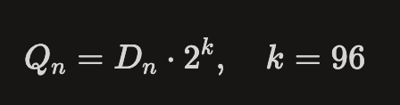

_Note!_ To get a human-readable price from `tick` or `sqrtPriceX96`, you always need the tokens' `decimals` and the order of the tokens in the pair.

## Where do I get tick, sqrtPriceX96, and decimals?

In the v3 protocol, all the values you need can be read directly from the pool's smart contract.

First, find the pool address. You can do this from the Uniswap [interface](https://app.uniswap.org/explore/pools/ethereum/0x4e68Ccd3E89f51C3074ca5072bbAC773960dFa36).

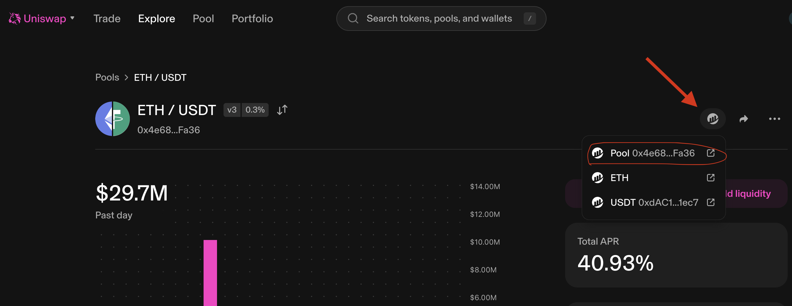

Open the contract in a block explorer and call `slot0()`.

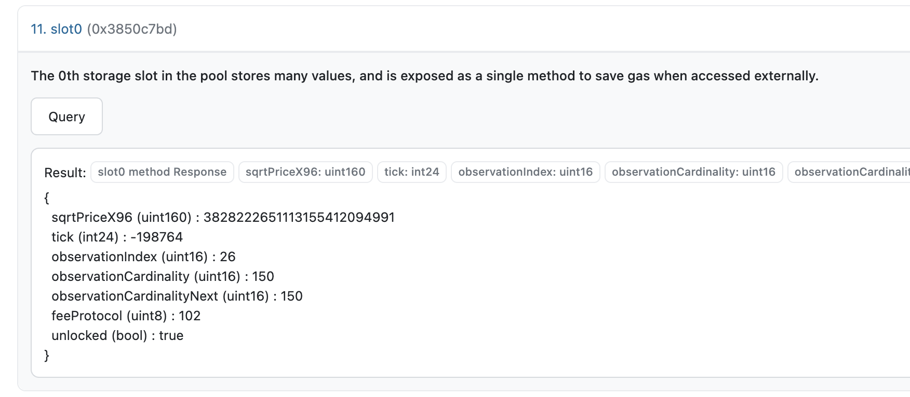

We also need to know which token in the pool is `token0` and which is `token1`. To check, call the corresponding functions on the pool contract.

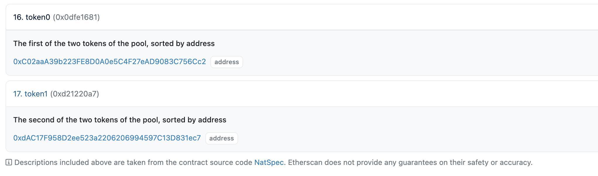

Opening those addresses in the explorer, we can see that in our case:

- token0: WETH (Decimals: 18)
- token1: USDT (Decimals: 6)

Now we have everything we need to derive the **human-readable price**.

## Calculating price from tick

In Uniswap v3, `tick` is related to price by this formula:

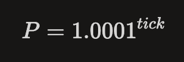

Here, price is `token1 / token0` in *raw units* — i.e. how much `token1` you need per 1 `token0`. For example, if `token0 = WETH` and `token1 = USDT`, then `P` tells you how much 1 WETH is worth in USDT.

**How do we turn this into a human-readable price?**

If you want the price of `token0` in `token1`, use:

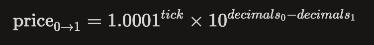

If you need the inverse price:

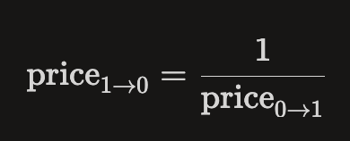

### Example for WETH/USDT

Suppose:

- `token0` = WETH, `decimals` = 18
- `token1` = USDT, `decimals` = 6
- `tick` = −198764

Then:


So first you get the raw price from `tick`, then multiply by `10^12` to adjust for the tokens' `decimals`.


## Calculating price from sqrtPriceX96

In Uniswap v3, `sqrtPriceX96` is related to price like this:

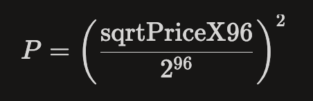

_Important!_ Again, this is a *raw price* — without accounting for `decimals`.

We divide by `2^96` to move from Q-notation back to decimal, and square the result to turn the square root back into the price.

If you want the price of `token0` in `token1`, use:

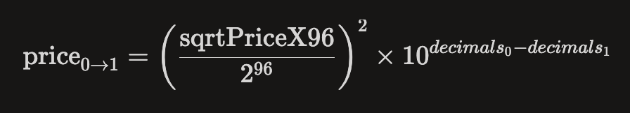

And for the inverse price:


### Example for WETH/USDT

Suppose:

- `token0` = WETH, `decimals` = 18
- `token1` = USDT, `decimals` = 6
- `sqrtPriceX96` = 3828222651113155412094991

Then the decimal-adjusted price can be calculated as follows:


And the inverse price:

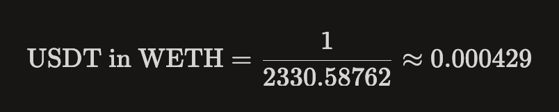

**Result:**
> 1 WETH ≈ 2330 USDT
> 1 USDT ≈ 0.000429 WETH

## Cheat sheet

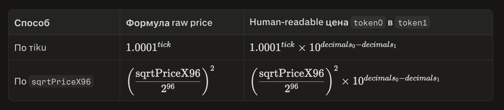

## Calculating price in v4

In v4, there are no separate pool contracts — everything lives in the *singleton* `PoolManager.sol`, where `poolId = keccak256(abi.encode(PoolKey))`.

You can get the `poolId` from the Uniswap interface. For example, for the [ETH/USDT](https://app.uniswap.org/explore/pools/ethereum/0x72331fcb696b0151904c03584b66dc8365bc63f8a144d89a773384e3a579ca73) pair.

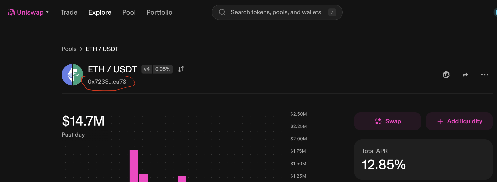

`PoolManager` doesn't expose a public `slot0()` function for reading `tick` and `sqrtPriceX96`. That's where [StateView](https://github.com/Uniswap/v4-periphery/blob/main/src/lens/StateView.sol) comes in — a peripheral *read-only* contract designed for querying pool state. You can find its deployment addresses in the official [documentation](https://developers.uniswap.org/docs/protocols/v4/deployments).

Call `getSlot0(poolId)` to retrieve `tick` and `sqrtPriceX96`.

From there, apply any of the v3 methods above to get the **human-readable price**.

**Why do the Uniswap v3 calculations still work for v4?**

Because the underlying math (concentrated liquidity) is implemented identically.

## Conclusion

_Heads up!_ The price derived from `tick` will differ from the price derived from `sqrtPriceX96`.

The price from `tick` is useful for range logic — checking whether the current price sits within `[tickLower, tickUpper]`.

This includes:
- Working with an LP position: when creating a position in Uniswap v3, you set `tickLower` and `tickUpper`.
- Checking the liquidity range: `tick` shows which price range the pool is currently in.
- Getting the price without high precision: `tick` is a convenient discrete, cheap-to-compute approximation of the spot price.
- Algorithms driven by price steps: `tick` is handy when what matters isn't the exact value but stepping across `ticks` by 0.01%.

The price from `sqrtPriceX96` is more precise and reflects the pool's current state. It's better suited when precision matters:
- When swapping one token for another.
- When calculating rewards.

**Summary**

**sqrtPriceX96** — for precise price calculation and swaps.
**tick** — for ranges, LP logic, approximations, and navigating price ranges.

## For JS/TS

A very common mistake in JS/TS is using the `Number` type to calculate the price. This leads to loss of precision: `sqrtPriceX96` is a `uint160`, and numbers that large don't fit into `Number` without truncating significant digits.

_Important!_ Use `BigInt`. But `BigInt` alone isn't enough — you need to order the operations correctly, because `BigInt` doesn't handle fractions and always rounds division down. The key rule: **multiply first, divide later**.

### Calculation from sqrtPriceX96

```ts
const sqrtPriceX96 = 3828222651113155412094991n;
const decimals0 = 18; // WETH (token0)
const decimals1 = 6;  // USDT (token1)

const Q192 = 2n ** 192n;

// 1. Square it in BigInt (stays integer, preserves precision)
const numerator = sqrtPriceX96 * sqrtPriceX96;

// 2. Account for decimals and add a PRECISION buffer,
//    which we'll "strip off" when converting to Number
const PRECISION = 18n;
const scale = 10n ** (BigInt(decimals0 - decimals1) + PRECISION);

// 3. Multiply first, divide later — otherwise BigInt would round the result down to 0
const priceScaled = (numerator * scale) / Q192;

// 4. Convert only the final result to Number
const price0in1 = Number(priceScaled) / 10 ** Number(PRECISION);

console.log(price0in1);      // ≈ 2330      (USDT per 1 WETH)
console.log(1 / price0in1);  // ≈ 0.000429  (WETH per 1 USDT)
```

**Why `2^192` instead of `2^96`?** The formula `(sqrtPriceX96 / 2^96)^2` is equivalent to `sqrtPriceX96² / 2^192`. If you divide by `2^96` first, then for typical prices (where `sqrtPriceX96 < 2^96`) `BigInt` returns `0` — and every subsequent step stays zeroed out. That's why we square first and only divide at the very end.

### Calculation from tick

`BigInt` won't help here: 1.0001 isn't an integer, and neither is the result — but `BigInt` only works with integers. `Number` handles this fine without losing significant digits, since the final result stays within a reasonable range.

```ts
const tick = -198764;
const rawPrice = Math.pow(1.0001, tick);
const price0in1 = rawPrice * 10 ** (decimals0 - decimals1);
console.log(price0in1); // ≈ 2340
```
